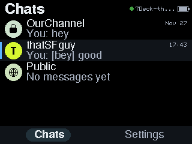
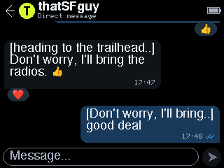

# MeshCore Extras

The official [MeshCore](https://github.com/meshcore-dev/MeshCore) firmware plus
extra firmwares and devices, kept in step with upstream releases. Everything
stock builds and behaves as upstream; the additions live alongside it.

**Contents**

- [What's included](#whats-included)
- [Quick start](#quick-start)
- [Guides](#guides)
- [Releases, issues and upstream](#releases-issues-and-upstream)
- [License](#license)

## What's included

**K.I.S.S. Messenger:** a standalone MeshCore messenger, so you can read and
type messages without a phone.
- **LilyGo T-Deck:** a colour interface modelled on the phone app, with emoji,
  reactions and replies.
- **LilyGo T-LoRa V2.1-1.6:** with a CardKB keyboard; the 3D-printable
  [case and build](https://cults3d.com/en/3d-model/gadget/k-i-s-s-meshtastic-qwerty-messenger-for-t-lora-cardkb-and-piezo-buzzer)
  are on Cults3D.
- **Works with the [MeshCore phone app](https://github.com/thatSFguy/meshcore-mobile-app)**:
  DM requests, channel links, reactions and replies.

<table>
  <tr>
    <td></td>
    <td></td>
  </tr>
</table>

**Personal Relay:** a relay for a parked car. It gives your own companions one
extra hop into the mesh, forwarding only what they send and copying back only
what's meant for them. It never advertises itself, so the mesh never learns a
route through a moving car, and it can pause itself while you're parked at
home. It runs on any board with a stock repeater build.

**GPS companion:** the stock Bluetooth companion for the LilyGo T-LoRa
V2.1-1.6 with an external GPS module.

## Quick start

Everything is done in the browser over USB, with **desktop Chrome or Edge**.
Phones and Firefox or Safari can still download the firmware files.

1. **Install:** open the
   [install page](https://thatsfguy.github.io/meshcore-extras/program.html),
   pick the firmware and your board, and flash it. ESP32 boards flash straight
   from the browser; nRF52 and RP2040 boards get a `.uf2` to drag onto the
   board's USB drive; STM32 boards get a `.hex`. When updating, leave *Erase
   device* unticked to keep your settings.
2. **Set it up:**
   - **K.I.S.S. on a T-Deck:** on first start, pick your region and a name on
     the device itself.
   - **K.I.S.S. on a T-LoRa:** pick a name on the device, then set the radio
     and channels on the
     [K.I.S.S. configuration page](https://thatsfguy.github.io/meshcore-extras/kiss.html).
   - **Personal Relay:** add your companions (required) and, optionally, group
     channels and home detection on the
     [relay configuration page](https://thatsfguy.github.io/meshcore-extras/relay.html).
     Until a companion is added it only listens.
3. **Use it:** see the guides below.

## Guides

- [**K.I.S.S. Messenger**](guides/kiss-messenger.md): using both devices,
  a wiring diagram for building your own, app compatibility, screenshots.
- [**Personal Relay**](guides/personal-relay.md): why it exists, setup step by
  step, the `edge` command reference, the packet policy.
- [**Building and the fork's layout**](guides/building.md): building from
  source, what this fork changes, the website.

## Releases, issues and upstream

- **Releases:** [all releases](https://github.com/thatSFguy/meshcore-extras/releases):
  K.I.S.S. Messenger and Personal Relay firmware files.
- **Issues and ideas:** [open an issue](https://github.com/thatSFguy/meshcore-extras/issues/new/choose).
- **Upstream:** this is a fork of
  [meshcore-dev/MeshCore](https://github.com/meshcore-dev/MeshCore), currently
  based on MeshCore v1.18.0. All core protocol, radio and platform code is
  theirs. For the stock firmware, see the
  [upstream README](https://github.com/meshcore-dev/MeshCore#readme).

## License

MIT, the same as upstream. See `LICENSE`.
