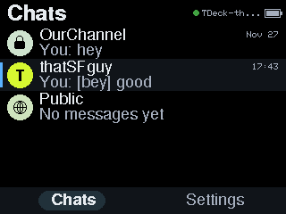
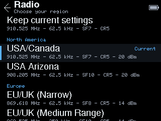
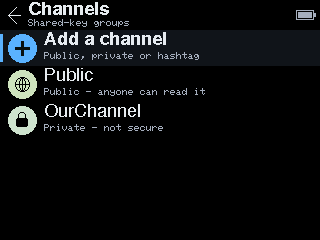
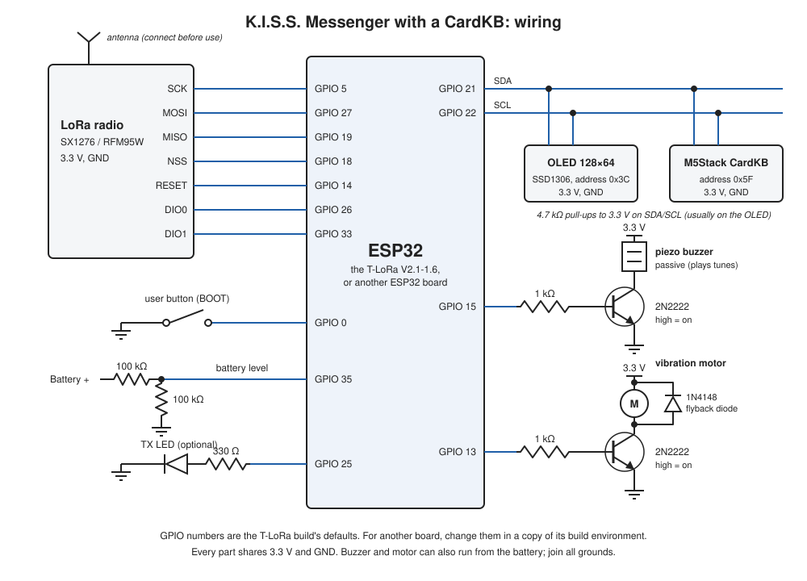

# K.I.S.S. Messenger

**Contents**

- [Overview](#overview)
- [Works with the MeshCore phone app](#works-with-the-meshcore-phone-app)
- [LilyGo T-Deck](#lilygo-t-deck)
- [LilyGo T-LoRa V2.1-1.6](#lilygo-t-lora-v21-16)
  - [Wiring](#wiring) and [your own board](#your-own-board)

## Overview

A standalone MeshCore messenger, no phone needed, on two devices. Both run the
companion firmware with their own on-device interface and no Bluetooth, work
like the phone app's simple mode, and keep messages across a restart (Keep
messages, on by default: saved to flash at most every 15 s; turning it off
clears all messages). Repeated copies of the same DM or channel post are shown
once.

A DM is sent up to three times, the last as a flood with a fresh route, as the
app does. If its delivery confirmation arrives within 30 s after that, it
still shows as delivered. A DM that is never confirmed shows a hint: usually
the other side doesn't have your key (the DM request only half completed, or
they removed you), so send a flood advert or ask for a DM again.

Releases: [K.I.S.S. Messenger releases](https://github.com/thatSFguy/meshcore-extras/releases?q=kiss-messenger)
(`-merged.bin` for a fresh install at 0x0, `.bin` to update at 0x10000), or
the [install page](https://thatsfguy.github.io/meshcore-extras/program.html).

## Works with the MeshCore phone app

Messages and channels are standard MeshCore, so a K.I.S.S. chats with any
MeshCore companion and app. Beyond that, it follows the conventions of the
[MeshCore phone app](https://github.com/thatSFguy/meshcore-mobile-app) (Android), so
the two work together:

| Feature | How it works together |
|---|---|
| Private DMs | The app's request/accept exchange in the group chat (`DM request for @[name] mch:r:…` / `DM accepted …`): either side can ask, either side can accept. |
| Channel sharing (T-Deck) | `meshcore://channel/add?name=…&secret=…`, the app's share link (also the official app's and `docs/qr_codes.md`'s format), sent by DM in either direction. |
| Reactions | Received from the app (its `r:HHHH:II` format, shared with MeshCore Open; MeshCore One's format is read too) and matched to their message exactly as the app does. The T-Deck also sends them, so they land on the right message in the app. |
| Replies | The app's `> Sender: quote` line; shown as `[quote] reply`, and the T-Deck sends replies the app shows as replies. |
| Radio presets, channel rules | The T-Deck's region picker is the app's 47 regional presets; adding channels follows the app's rules (public, hashtag, private). |
| Look (T-Deck) | The app's dark theme, avatar colours and letters, delivery ticks and wording. |

## LilyGo T-Deck

The T-Deck's keyboard, touch screen and speaker, with a colour interface
modelled on the phone app: chat list with avatars, message bubbles with
delivery ticks (✓ sent, ✓✓ delivered, ✗ failed), and the app's dark theme and
wording.

<table>
  <tr>
    <td> Chat list</td>
    <td> Replies, emoji and reactions</td>
  </tr>
  <tr>
    <td> A private channel</td>
    <td> React</td>
  </tr>
  <tr>
    <td> Region presets</td>
    <td> Channels</td>
  </tr>
</table>

- **Install:** [install page](https://thatsfguy.github.io/meshcore-extras/program.html)
  → *K.I.S.S. Messenger* → *LilyGo TDeck*, or build target
  `LilyGo_TDeck_kiss_messenger`.
- **First start** asks for a name, then for your region: the app's 47
  regional radio presets.
- **Input:** type on the keyboard, tap and scroll on the screen; the trackball
  moves and its click selects.
- **Chats:** tap a message for its options: react, reply, message the
  sender privately, accept a DM request, mention, resend a failed DM.
- **Emoji** are drawn in colour, in messages, names and reactions (the
  app's 184 reaction emoji; Noto Emoji images, Apache 2.0). Others show as
  `?`.
- **Reactions** show as chips under the message they're for (👍 2 🔥), and
  only reactions to your own messages count as new. **React** offers the
  app's six quick reactions.
- **Replies:** **Reply** shows *Replying to …* above the text box (tap X or
  press backspace on an empty box to cancel); a received reply shows its
  quote in brackets: `[why] why what?`.
- **Channels** (Settings → Channels): join Public or a hashtag channel, create
  a private one, or join one with its key. **Share** on a channel's page sends
  it to a contact by DM as a `meshcore://channel/add` link (the app's share
  format); a link received in a DM offers *Join <name>?*, and the key is never
  shown in the chat.
- **Settings** also cover adverts, sound, time zone, screen timeout, Keep
  messages and Clear all messages.

## LilyGo T-LoRa V2.1-1.6

A LilyGo T-LoRa V2.1-1.6 with an M5Stack CardKB
keyboard, a piezo buzzer and a vibration motor, in a 3D-printed case. Read and
type messages on its OLED, no phone needed. It runs the MeshCore companion
firmware with its own on-device interface (`ui-kiss`) and no Bluetooth; the
phone app can still connect over a USB-OTG cable.

**Build your own:** the 3D-printable case and build for this device (T-LoRa,
CardKB and piezo buzzer) are on Cults3D:
[K.I.S.S. QWERTY messenger for T-LoRa, CardKB and piezo buzzer](https://cults3d.com/en/3d-model/gadget/k-i-s-s-meshtastic-qwerty-messenger-for-t-lora-cardkb-and-piezo-buzzer).

**Wiring**

The diagram is generic: an ESP32, an SX1276 LoRa radio, an I2C OLED and a
CardKB, plus a few small parts. On a T-LoRa V2.1-1.6 the radio, OLED, button,
battery divider and LED are already on the board, so you only add the CardKB,
the buzzer and the motor. To use another board, see
[Your own board](#your-own-board).

| Part | Connection (T-LoRa build) | Notes |
|---|---|---|
| LoRa radio (SX1276 / RFM95W) | SPI: SCK 5, MOSI 27, MISO 19, NSS 18; RESET 14, DIO0 26, DIO1 33 | Connect the antenna before powering on. |
| OLED, 128×64 SSD1306 | I2C: SDA 21, SCL 22, address 0x3C | Shares the bus with the CardKB. |
| M5Stack CardKB | Same I2C bus, address 0x5F; 3.3 V and GND | The bus needs 4.7 kΩ pull-ups to 3.3 V (most OLED boards have them). |
| Piezo buzzer | GPIO 15 → 1 kΩ → 2N2222 base; buzzer from 3.3 V to the collector | A passive piezo: the firmware plays tunes. High = on. Optional. |
| Vibration motor | GPIO 13 → 1 kΩ → 2N2222 base; motor from 3.3 V to the collector, 1N4148 across it | The diode's band goes to the supply side. High = on. Optional. |
| User button | GPIO 0 to GND (the BOOT button) | Turns the screen on or off. |
| Battery level | GPIO 35, from two equal resistors (100 kΩ) between battery + and GND | The firmware doubles the reading, so the divider must halve the voltage. |
| TX LED | GPIO 25 → 330 Ω → LED → GND | Lights while transmitting. Optional. |

All parts share GND. The buzzer and motor can run from the battery instead of
3.3 V; the transistor still switches them from a 3.3 V GPIO.

**Your own board.** Any ESP32 with an SX1276 or RFM95W radio works, with the
pins changed to match. In `variants/lilygo_tlora_v2_1/platformio.ini`, copy
the `[LilyGo_TLora_V2_1_1_6]` section under a new name and change its pin
flags (`P_LORA_*`, `PIN_BOARD_SDA`/`PIN_BOARD_SCL`, `PIN_VBAT_READ`,
`P_LORA_TX_LED`, `PIN_USER_BTN`). Then copy `[env:LilyGo_TLora_V2_1_1_6_kiss_messenger]`,
point it at your section, and set `PIN_BUZZER` and `PIN_VIBRATION`. Leave
either one out if you don't fit that part. Build it with
`pio run -e <your env name>`.

- If your OLED has a reset pin, set `-D PIN_OLED_RESET=<gpio>`. Otherwise set
  `-D PIN_OLED_RESET=-1`, because the default (21) would toggle a pin you may
  be using for something else.
- Choose output pins carefully. GPIO 6–11 belong to the flash chip, and GPIO
  34–39 are input only (fine for the battery, not for the buzzer or motor).
  GPIO 12 must not be pulled high at boot. GPIO 0, 2 and 15 are boot pins:
  they are fine behind a 1 kΩ resistor to a transistor, but nothing may hold
  them high or low while the board starts.
- Another radio chip (SX1262, LLCC68) needs a different radio class and a BUSY
  pin; copy those flags from a board in `variants/` that uses that chip.

**Install:** [install page](https://thatsfguy.github.io/meshcore-extras/program.html)
→ *K.I.S.S. Messenger*, or build target `LilyGo_TLora_V2_1_1_6_kiss_messenger`.
Don't flash the GPS companion build to this hardware: it uses GPIO 15/13 for
the GPS. **Set up:** on first boot it asks for a name. Then use the
[K.I.S.S. configuration page](https://thatsfguy.github.io/meshcore-extras/kiss.html)
for the radio (USA / Canada and EU / UK presets) and channels.

**Using it**

| Screen | Keys |
|---|---|
| Chat list | Up/Down to choose, Enter to open, or just start typing. Esc opens the menu. |
| Chat | Type, Enter to send. Up/Down scrolls. Tab asks someone in the channel for a DM. Esc goes back. |
| Menu | Flood / zero-hop advert, name, sound on/off, vibrate on/off, keep messages on/off, about |

The screen sleeps after a minute; the first key press only wakes it. The BOOT
button turns the screen on or off. Sent DMs show `..` while sending, `+` when
delivered and `!` if delivery failed.

**Reactions and replies** from the app read as one line each:
`Bob [why] reacted with thumbs up` (emoji named in words, as the OLED can't
draw them) and `Bob [why] why what?`.

**Simple mode.** Like the phone app's simple mode, it never adds contacts on
its own. To DM someone, ask in the group chat: Tab, pick the person, Enter.
That posts `DM request for @[name] mch:r:<your key>`; when they accept (on a
K.I.S.S. or in the app), their reply carries their key and both sides add each
other. No adverts are involved.

**Clock.** With no app or GPS, the clock is taken from the mesh, but only when
two different nodes agree on the time, so one node with a wrong clock can't
drag it along. The configuration page also sets it from your computer.
